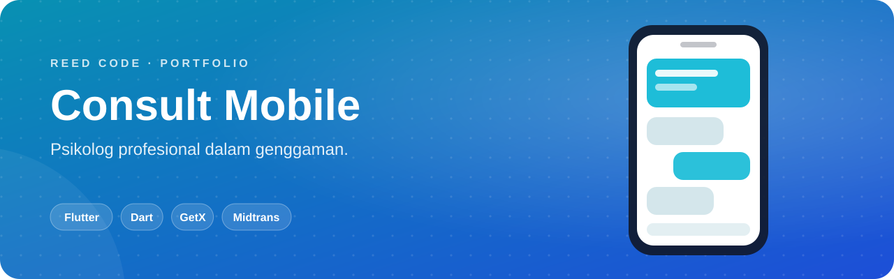
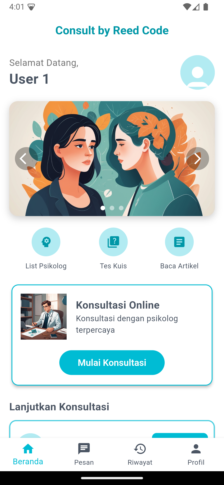
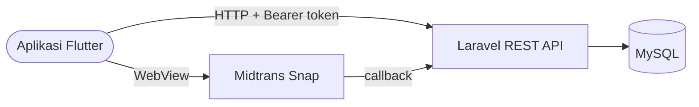

<p align="center">
  
</p>

<p align="center">
  <b>Teman bercerita di saku.</b> Versi mobile Consult by Reed Code untuk tes kesehatan mental, memilih psikolog, membayar, dan chat dari HP.
</p>

<p align="center">
  <a href="#sekilas">Sekilas</a> ·
  <a href="#kemampuan">Kemampuan</a> ·
  <a href="#alur-kerja">Alur Kerja</a> ·
  <a href="#mulai-menjalankan">Mulai Menjalankan</a> ·
  <a href="#menghubungkan-ke-backend">Backend</a> ·
  <a href="#akun-demo">Akun Demo</a>
</p>

<p align="center">
  
  <br>
  
  
  
</p>

## Sekilas

Aplikasi Flutter ini adalah pintu masuk mobile untuk platform **Consult by Reed Code**. Seluruh data (akun, psikolog, transaksi, dan chat) disajikan oleh backend Laravel di [psychology-consultation-laravel](https://github.com/KyyStacy/psychology-consultation-laravel), jadi jalankan backend itu lebih dulu.

<p align="center">
  
</p>

## Kemampuan

<table>
  <tr>
    <td width="50%" valign="top"><b>🔐 Login & Registrasi</b><br>Sesi tetap tersimpan saat aplikasi dibuka ulang.</td>
    <td width="50%" valign="top"><b>🏠 Beranda</b><br>Slider promo dan artikel seputar kesehatan mental.</td>
  </tr>
  <tr>
    <td valign="top"><b>🧩 Tes Kesehatan Mental</b><br>Kuis singkat untuk mengenali kondisi diri.</td>
    <td valign="top"><b>🧑‍⚕️ Daftar Psikolog</b><br>Foto, bio, tarif, dan status online.</td>
  </tr>
  <tr>
    <td valign="top"><b>💳 Pembayaran</b><br>Pilih metode dan selesaikan pembayaran Midtrans lewat WebView.</td>
    <td valign="top"><b>💬 Chat</b><br>Daftar percakapan dan ruang chat dengan psikolog.</td>
  </tr>
  <tr>
    <td valign="top"><b>🧾 Riwayat</b><br>Status pembayaran dan sesi konsultasi.</td>
    <td valign="top"><b>👤 Profil</b><br>Ubah data diri, foto (kamera/galeri), dan password.</td>
  </tr>
</table>

## Alur Kerja



| Folder | Isi |
|---|---|
| `lib/config/` | `api_config.dart`: base URL API, WebSocket, dan storage |
| `lib/services/` | Auth, chat, transaksi, konfigurasi Midtrans |
| `lib/models/` | User, Psychologist, Transaction, Message |
| `lib/Views/` | Semua layar aplikasi |

## Mulai Menjalankan

> Butuh **Flutter SDK 3.x**, **Android Studio** atau **Xcode**, dan backend Laravel yang sudah berjalan.

```bash
git clone https://github.com/KyyStacy/psychology-consultation-flutter.git
cd psychology-consultation-flutter
flutter pub get
flutter run
```

<details>
<summary><b>Build APK rilis</b></summary>

<br>

```bash
flutter build apk --release --dart-define=API_BASE_URL=https://api.domain-kamu.com
```

</details>

## Menghubungkan ke Backend

Tanpa konfigurasi tambahan, aplikasi memilih alamat backend secara otomatis:

| Dijalankan di | Base URL |
|---|---|
| Android Emulator | `http://10.0.2.2:8000` |
| iOS Simulator · Web · Desktop | `http://localhost:8000` |

Untuk HP fisik atau server production, kirim alamatnya saat run/build:

```bash
flutter run --dart-define=API_BASE_URL=http://192.168.1.10:8000
```

> Saat memakai HP fisik, jalankan backend dengan `php artisan serve --host=0.0.0.0` dan pastikan HP berada di jaringan yang sama.

## Akun Demo

Akun berasal dari seeder backend, dengan password `password`:

`user@reedcode.id` · `user2@reedcode.id` · `user3@reedcode.id`

---

<div align="center">

<h2>Dibuat oleh Kyy Stacy × Reed Code</h2>

<p><i>Web & app developer: dari landing page sampai sistem bisnis custom.</i></p>

<a href="https://www.instagram.com/reedcode.id"></a>
<a href="https://www.tiktok.com/@reedcode.id"></a>
<a href="https://github.com/KyyStacy"></a>

<br><br>

<table>
  <tr>
    <td colspan="4" align="center"><b>Punya ide aplikasi atau butuh website untuk bisnismu?</b><br><sub>Reed Code siap bantu dari desain sampai online.</sub></td>
  </tr>
  <tr>
    <td align="center" width="25%">🌐<br><b>Company Profile</b><br><sub>Website brand & usaha</sub></td>
    <td align="center" width="25%">🛒<br><b>Toko Online</b><br><sub>Katalog & pembayaran online</sub></td>
    <td align="center" width="25%">📊<br><b>Sistem Bisnis</b><br><sub>Kasir, inventaris, booking</sub></td>
    <td align="center" width="25%">📱<br><b>Aplikasi Mobile</b><br><sub>Android & iOS</sub></td>
  </tr>
</table>

<a href="https://wa.me/6285171713355?text=Halo%20Reed%20Code%2C%20saya%20tertarik%20dengan%20jasa%20pembuatan%20website"></a>

<br><br>

<sub>© 2026 Kyy Stacy · Reed Code</sub>

</div>
